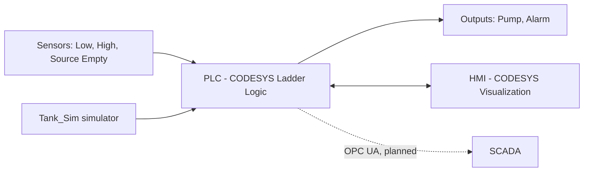
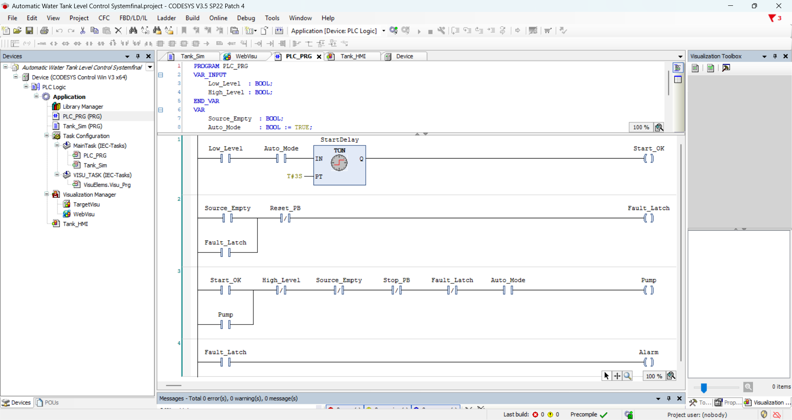
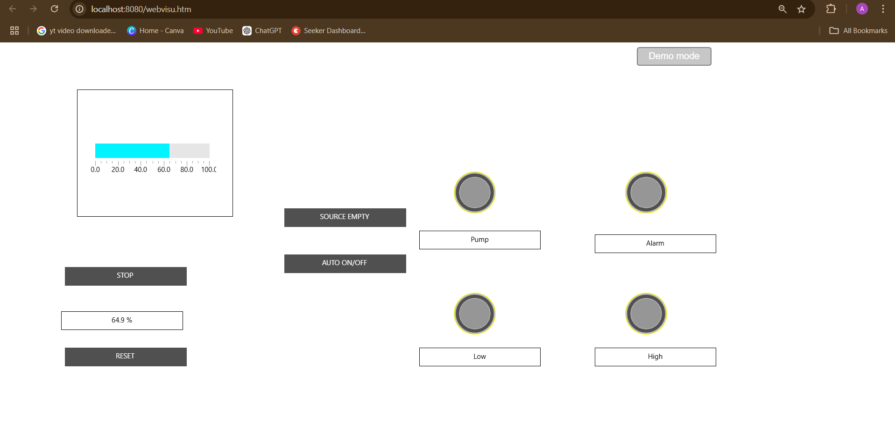

# Automatic Water Tank Level Control System (PLC + HMI)

An automatic water tank level controller built in **CODESYS V3.5** using **Ladder Logic**, with an operator **HMI** and a planned **SCADA (OPC UA)** layer. The system fills the tank automatically, stops at high level, and protects the pump against dry running with a latched alarm.

  

## Features

- Automatic filling when the tank level is low
- 3 s start-delay timer (filters sensor flicker)
- Pump seal-in circuit (runs until high level)
- High-level (overflow) protection
- Dry-run protection with a **latched fault** and manual reset
- Alarm output
- Operator HMI: level bar, status lamps, Stop / Reset / Auto / Source-Empty test buttons
- Tank simulator program so the project runs with no hardware

## Skills demonstrated

Ladder Logic · TON timers · Seal-in circuits · Interlocks · Latched faults · Fail-safe (normally closed) design · HMI design · Variable binding · Simulation and testing

## System overview



## I/O list

| Name | Type | Direction | Description |
|---|---|---|---|
| `Low_Level` | BOOL | Input | TRUE when the level is below the low mark |
| `High_Level` | BOOL | Input | TRUE when the level reaches the high mark |
| `Source_Empty` | BOOL | Input | TRUE when the source has no water (dry-run) |
| `Auto_Mode` | BOOL | Input / HMI | Enables automatic operation (default TRUE) |
| `Stop_PB` | BOOL | Input / HMI | Stop button |
| `Reset_PB` | BOOL | Input / HMI | Clears the latched fault |
| `Pump` | BOOL | Output | Pump contactor |
| `Alarm` | BOOL | Output | Alarm lamp / horn |

In simulation, `Low_Level` and `High_Level` are driven by `Tank_Sim`. On real hardware they map to physical inputs (for example `%IX0.0`, `%IX0.1`).

## Control logic (4 rungs)

| Rung | Logic | Purpose |
|---|---|---|
| 1 | `Low_Level AND Auto_Mode` → TON `StartDelay` (T#3S) → `Start_OK` | Start delay |
| 2 | `(Source_Empty OR Fault_Latch) AND NOT Reset_PB` → `Fault_Latch` | Latched dry-run fault |
| 3 | `(Start_OK OR Pump) AND NOT High_Level AND NOT Source_Empty AND NOT Stop_PB AND NOT Fault_Latch AND Auto_Mode` → `Pump` | Pump control with seal-in |
| 4 | `Fault_Latch` → `Alarm` | Alarm |



An equivalent Structured Text version is in [`src/PLC_PRG_equivalent.st`](src/PLC_PRG_equivalent.st).

### Design decisions

- **Timer:** stops sensor flicker from starting and stopping the pump repeatedly.
- **Seal-in:** `Start_OK` is only TRUE while the level is low, so the `Pump` contact in parallel keeps the pump running until a stop condition.
- **Normally closed safety contacts:** a broken wire or failed sensor stops the pump (fail-safe).
- **Latched fault:** the alarm stays on until a person checks the cause and presses Reset.

## HMI

Built with CODESYS Visualization (`Tank_HMI`). See [`hmi/HMI_Build_Guide.md`](hmi/HMI_Build_Guide.md).



## Test results

Seven test cases are in [`docs/Test_Cases.md`](docs/Test_Cases.md): auto fill, seal-in, high-level stop, restart, dry-run alarm, reset and stop.

## SCADA (OPC UA)

**Status: planned.** The design (tag map, OPC UA setup, alarms, trends) is in [`scada/SCADA_Plan.md`](scada/SCADA_Plan.md).

## How to run

1. Install **CODESYS V3.5 SP22** (or later) from codesys.com.
2. Open the project from [`project/`](project/) (or import the PLCopenXML file).
3. **Build → Build**, then **Online → Login → Yes**, then press **F5**.
4. Open the `Tank_HMI` tab to see the HMI. The browser view (`http://localhost:8080/webvisu.htm`) needs the CODESYS Control Win runtime instead of Simulation mode.

## Possible improvements

- Dual-pump alternation and a run-time counter
- Motor overload and "pump failed to start" alarms
- Analog level transmitter with hysteresis
- Secured OPC UA connection with user roles
- Complete the SCADA layer with alarms and trends

## Repository structure

```
├── README.md
├── src/            PLC source (declarations, simulator, ST equivalent)
├── docs/           Test cases and interview notes
├── hmi/            HMI build guide
├── scada/          SCADA plan and tag map
├── images/         Screenshots (add yours here)
└── project/        CODESYS project / PLCopenXML export
```

## License

MIT
